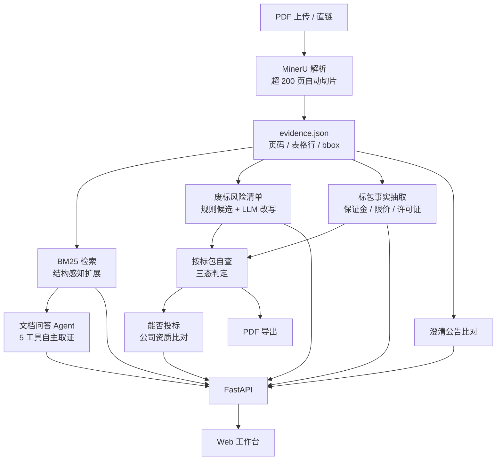

# 标书智查（BidLens）

招标文件智能问答与条款复核助手。

面向投标方的**招标文件复核助手**：把一份 PDF 招标文件变成可逐项核对的风险清单、按标包的自查清单，并判断「我这个公司能不能投这个包」。有引用的条目可跳回原 PDF 页面核对。

最有代表性的流程是**澄清公告变更后重新复核**。例如，第 2 包最高限价由 573,290 元改为 178,810 元，清单会要求复核这一项，展示原文件和澄清公告的引用，保留旧确认人和时间。其他条目及标包的确认继续有效。


[运行无 Key 演示](#无-api-key-演示) · [使用说明](docs/quickstart.md) · [评测与复现](eval/README.md) · [设计取舍](docs/design-decisions.md)

## 一次澄清，怎么复核

以下是演示文件的预期结果。关联澄清公告后，第 2 包有三项需要重新确认。第 1 包的限价和截止时间确认继续有效。

| 第 2 包条目 | 原招标文件 | 澄清公告 |
|---|---|---|
| 最高限价 | 75 万元 | 80 万元 |
| 投标截止时间 | 9 月 22 日 14:30 | 9 月 28 日 14:30 |
| 证照要求 | 须提供食品经营许可证 | 取消该要求 |

打开任意一项可查看双方的原文页码和旧确认记录。重新确认后，该项会从「变更后待复核」列表消失。

## 无 API Key 演示

在项目根目录安装依赖并启动演示。

```bash
python -m pip install -r requirements.txt
python scripts/seed_revision_demo.py
python -m uvicorn web_app:app --port 8780
```

打开 http://127.0.0.1:8780，点击「体验无 Key 演示」。先看第 2 包的历史确认，再点击「关联演示公告并查看待复核」，逐项核对三处变更并导出。

两份 PDF 均由脚本生成，重复运行会保留已有演示确认。详细操作、预期结果和真实文件的使用流程见 [工作台使用说明](docs/quickstart.md)。


---

## 它解决什么问题

一份 100～200 页的招标文件里，真正决定成败的信息散落在各处：

- 废标条件分散在「投标人须知」「资格审查标准」「符合性审查标准」，还有附件里的审查表
- 投标保证金、最高限价按标包分别规定，表格里的数字容易看串行
- 特定资格许可证只对某几个标包有效（如「标段一至四需 A 证，标段五需 A+B 证」）
- 澄清公告会把限价、截止时间改掉，需要和原文件比对

逐条核对需要保留页码和确认记录。工作台把证据、待复核条目和确认历史放在同一份清单里。

---

## 核心能力

| 能力 | 说明 |
|---|---|
| **PDF 解析** | MinerU（OCR + 版面还原），超 200 页自动切片并校正页码；证据块保留原 PDF 页码与 bbox |
| **表格按行拆解** | 表格拆成独立行作为检索单元，并用 8 字短语回扫 PDF 文本层反查真实页码，避免跨页表格串行 |
| **废标风险清单** | 规则召回候选 → 大模型改写为「触发条件 + 核对动作」→ 交叉引用消歧 → 人工逐条确认 |
| **按标包自查** | 抽取标包、保证金、限价、许可证、评标方法，输出 `适用 / 待核对 / 不适用` 三态 + 依据页码 |
| **能否投标** | 公司资质档案 × 招标要求比对，输出 `满足 / 不满足 / 待确认`；**缺失不等于不满足**，无明确证据一律待确认 |
| **澄清公告比对** | 比对限价、投标截止时间和证照资格，明确命中的清单条目进入复核，保留旧确认和两份文件的引用 |
| **按标包评分** | 区分独立评分表和多包共用表，逐项展示满分及证据页，支持追问另一个标包 |
| **文档问答 Agent** | 模型自主决定调用 5 个工具（检索 / 精读页码 / 标包事实 / 风险清单 / 文档结构），多轮取证后作答，引用编号必须来自已取证据 |
| **团队协作** | 账号注册登录、群组、文档授权、确认记录可追溯（SQLite） |

---

## 关键设计取舍

### 不用向量检索

招标文件是**强结构文档**，条款按编号组织，检索以中文 bigram BM25 为基础，并扩展标题和表格的上下文。

- 命中标题时自动带出同页后续正文（避免只召回「3 投标人资格要求」而丢失具体条款）
- 命中表格表头时带出整表；**跨页表按表头签名合并**（如评分表被切在 4 个页面上）
- 评分类问题按「分值 / 评审因素 / 满分」特征强制召回

按标包评分验收覆盖 5 份文件、17 道问题。评测用例和复现步骤见 [评测目录](eval/README.md)。

### 表格按行拆解 + 页码反查

跨页表格按行提取，再回到原 PDF 核对每一行所在的页码。

1. 用 HTML parser 还原 `colspan` / `rowspan`
2. 每行作为独立检索单元
3. 用每行前 48 字切成 8 字短语，在 PDF 文本层里查出现页
4. 命中则修正页码，未命中标记 `page_verified=false` 由前端提示

### 确定性规则 + 模型双轨

能用规则确定的就不给模型：

- 保证金金额、限价、标包号 → 正则抽取，附回归测试
- 标包适用范围、免收判定 → 规则判断
- 模型只负责「条款改写」和「问答」

### 长文档并发

同一进程内，文档版本由 PDF 和证据文件的修改时间、大小共同确定。多个请求访问同一版本时，共享一次证据准备、索引构建和标包事实计算。不同进程各自缓存。

206 页样本实测，三个冷请求同时到达，PDF 读取 **6 次 → 1 次**，整组用时 **58.5 秒 → 21.1 秒**。两轮都调用了真实模型，模型耗时会波动。详见 [评测说明](eval/README.md)。

### Agent 引用硬校验

系统校验模型返回的 `evidence_ids`。如果没有有效编号，会把已取证据编号交给模型重答。引用可定位到原文，结论是否完整仍需要评测和人工复核。

---

## 快速开始

### 方式一：Docker

```bash
git clone <repo> && cd tender-review
cp .env.example .env      # 填入下面三个 Key
docker compose up --build
```

打开 http://127.0.0.1:8780

### 方式二：本地运行

需要 Python ≥ 3.11。

```bash
python -m venv .venv
# Windows
.venv\Scripts\activate
# macOS / Linux
source .venv/bin/activate

pip install -r requirements.txt
cp .env.example .env     # 填入 Key
python -m uvicorn web_app:app --host 127.0.0.1 --port 8780
```

启用团队协作模式（需要登录）：

```bash
# Windows PowerShell
$env:TENDER_TEAM="1"
python -m uvicorn web_app:app --port 8780

# macOS / Linux
TENDER_TEAM=1 python -m uvicorn web_app:app --port 8780
```

首次启动会建 `data/team.sqlite3`，页面点「注册新账号」创建第一个账号。

### 配置

`.env` 三项必填：

| 变量 | 说明 | 获取 |
|---|---|---|
| `MINERU_API_TOKEN` | PDF 解析（OCR、表格还原） | [mineru.net](https://mineru.net) → API 管理 |
| `DASHSCOPE_API_KEY` | 大模型调用 | [阿里云百炼](https://bailian.console.aliyun.com) → API-KEY |
| `DASHSCOPE_BASE_URL` | 兼容 OpenAI 协议的地址 | 默认 `https://dashscope.aliyuncs.com/compatible-mode/v1` |
| `DASHSCOPE_MODEL` | 模型名 | 如 `qwen-plus` |

模型走 OpenAI 兼容协议，换厂商只需改 `DASHSCOPE_BASE_URL` 和 `DASHSCOPE_MODEL`。

---

## 复核真实文件

1. 导入原招标 PDF，等待解析和风险清单生成。
2. 选择标包，展开风险条目或在问答中查看评分，点击引用核对原页。
3. 如有澄清公告，导入后切回原文件并关联公告，查看当前标包受影响的条目。
4. 逐项确认后导出清单。需要判断企业资格时，可在「能否投标」中关联公司档案。

按钮位置和操作结果见 [工作台使用说明](docs/quickstart.md#复核自己的招标文件)。

## 架构



### 模块

| 文件 | 职责 |
|---|---|
| `mineru_pdf.py` | MinerU API 调用、证据块生成 |
| `document_import.py` | 上传/直链/切片导入、任务状态机、SSRF 防护 |
| `retrieve_evidence.py` | BM25 索引、表格行拆解、页码反查、上下文扩展 |
| `risk_review.py` | 废标条款候选召回、分批 LLM、引用消歧 |
| `package_review.py` | 标包事实抽取、按标包自查 |
| `company_profile.py` | 公司档案、资质三态匹配 |
| `tender_agent.py` | 问答 Agent：工具定义、多轮循环、引用校验 |
| `document_compare.py` | 澄清公告字段级 diff |
| `checklist_export.py` | 打印视图（可另存 PDF） |
| `team_store.py` | SQLite：用户、会话、群组、授权、确认 |
| `web_app.py` | FastAPI 路由与鉴权中间件 |

---

## 测试

```bash
# 全部（含需要模型 API 的问答测试）
pytest tests -q

# 跳过需要网络的用例
pytest tests -q -m "not live"
```

| 测试 | 用例数 | 说明 |
|---|---|---|
| `test_packages.py` | 25 | 标包抽取回归：金额、页码、适用范围三态、全量快照 |
| `test_qa.py` + `qa_cases.json` | 56 | 28 条人工验证问答 × 2 类校验（答案事实 / 引用合法性） |
| `test_document_compare.py` | 若干 | 澄清公告 diff |
| `test_team_sharing.py` | 若干 | 并发确认、群组共享 |
| `eval/check_benchmark.py` | — | 十份文档基准评测 |

回归门槛：修改抽取规则后必须全绿。`tests/baseline.json` 是 17 份文档的全量快照，有意变更后删除重跑。

---

## 目录

```
.
├── web_app.py               FastAPI 入口
├── tender_agent.py          问答 Agent
├── retrieve_evidence.py     检索
├── risk_review.py           风险清单
├── package_review.py        标包自查
├── company_profile.py       公司资质
├── document_compare.py      澄清比对
├── document_import.py       导入流水线
├── mineru_pdf.py            MinerU 客户端
├── checklist_export.py      PDF 导出
├── team_store.py            团队存储
├── web/                     前端（原生 JS + CSS）
├── tests/                   测试
├── eval/                    基准评测
├── data/imports/            导入文档（不纳入版本控制）
└── profiles/                公司档案（不纳入版本控制）
```

---

## 已知限制

- **仅支持 PDF**。Word / Excel 招标文件需先转换。
- **每份原文件可关联一份澄清公告**。复核联动覆盖可识别的最高限价、投标截止时间和证照资格变更。
- **抽取规则是长尾**。许可证只识别「标段 X 须具有《…许可证》」句式；限价只识别「最高限价 / 合同包最高限价」。分段写法等变体需要补规则，因此有回归测试兜底。
- **扫描件效果取决于 OCR**。`uncovered_pages` 会标出无法提取文字的页。
- **未解析页不参与结论**。只提示存在，不猜测内容。
- **单机部署**。SQLite + 本地文件存储，未做多机横向扩展。
- **无多租户计费**。团队模式基于单实例账号体系。

---

## 许可

MIT